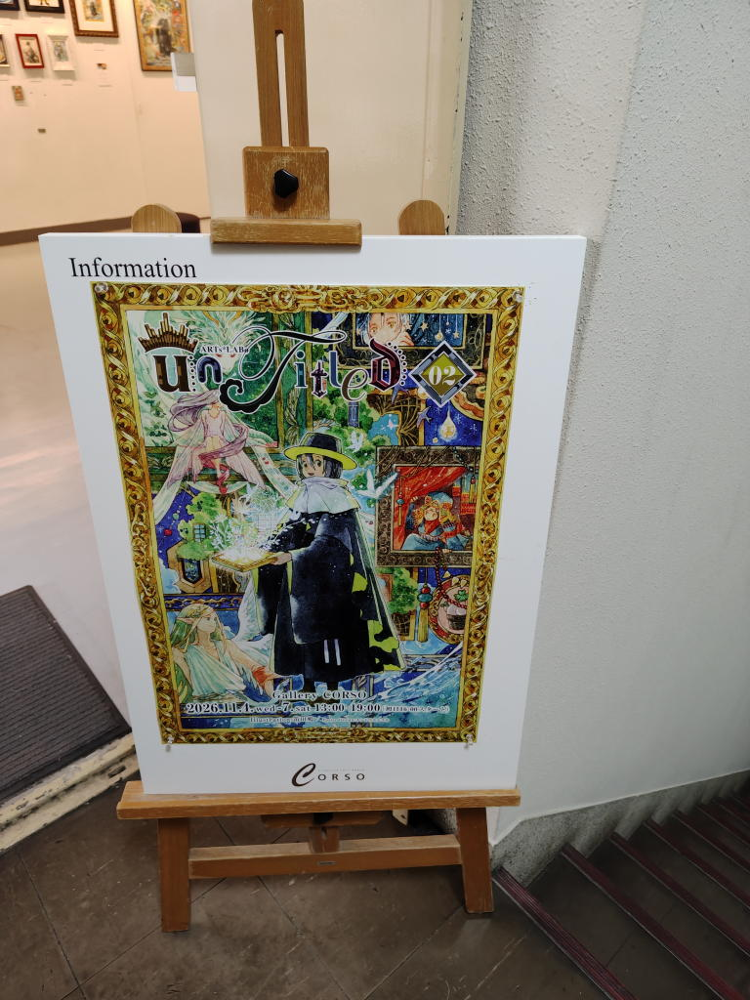
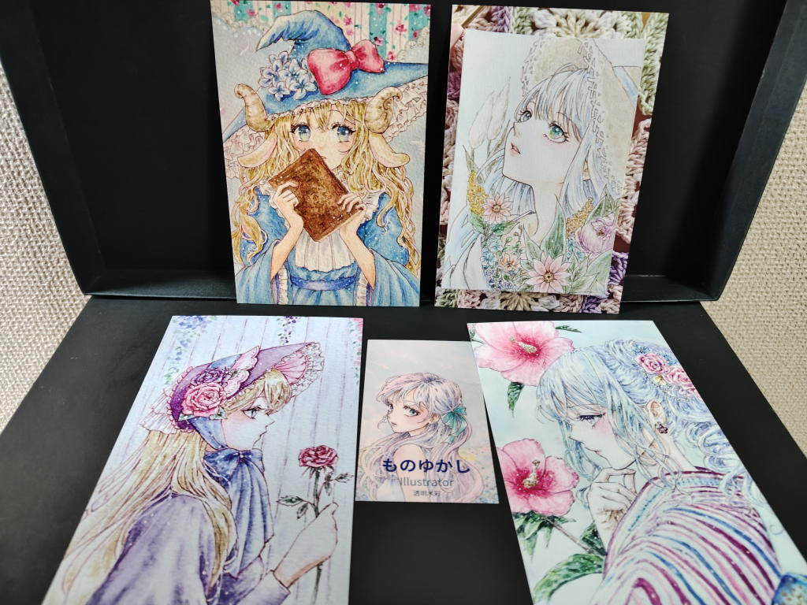
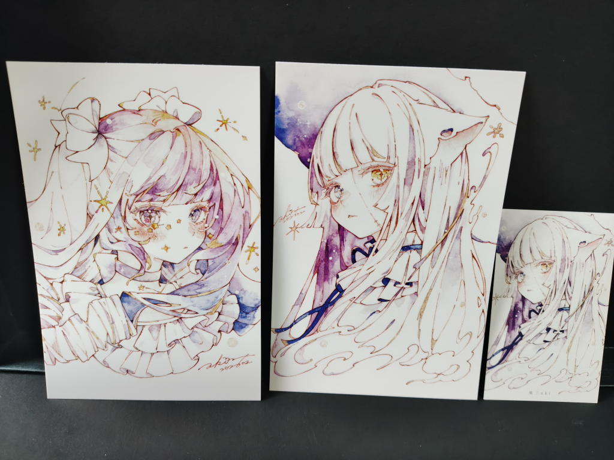
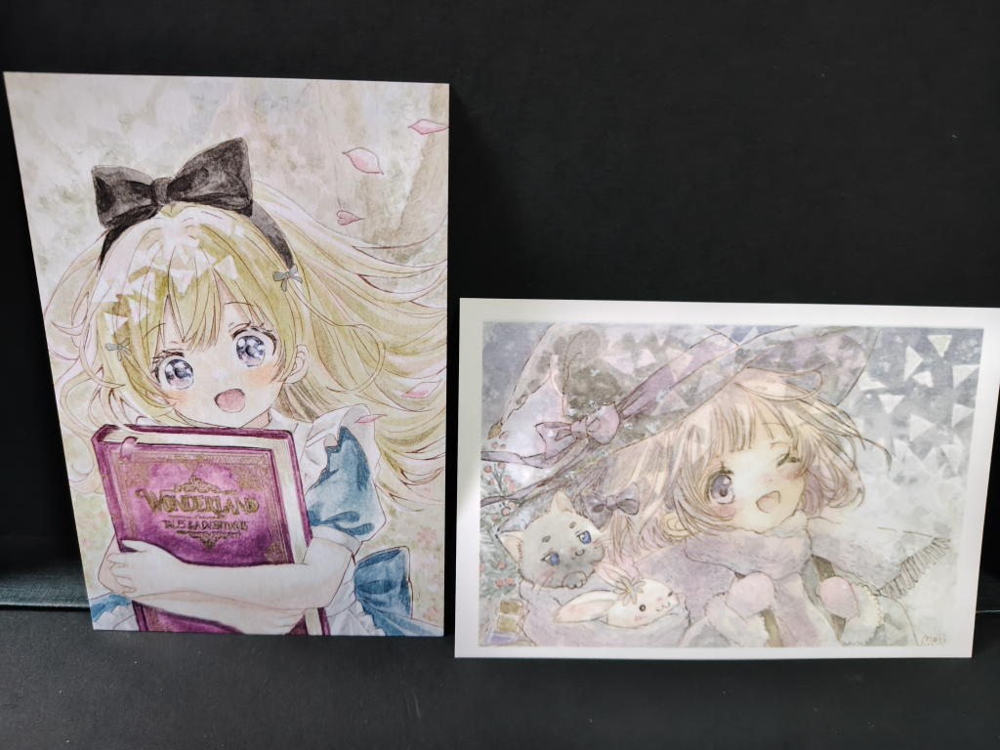
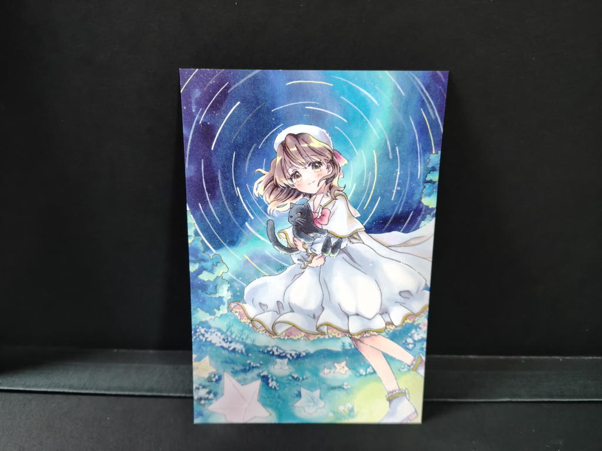
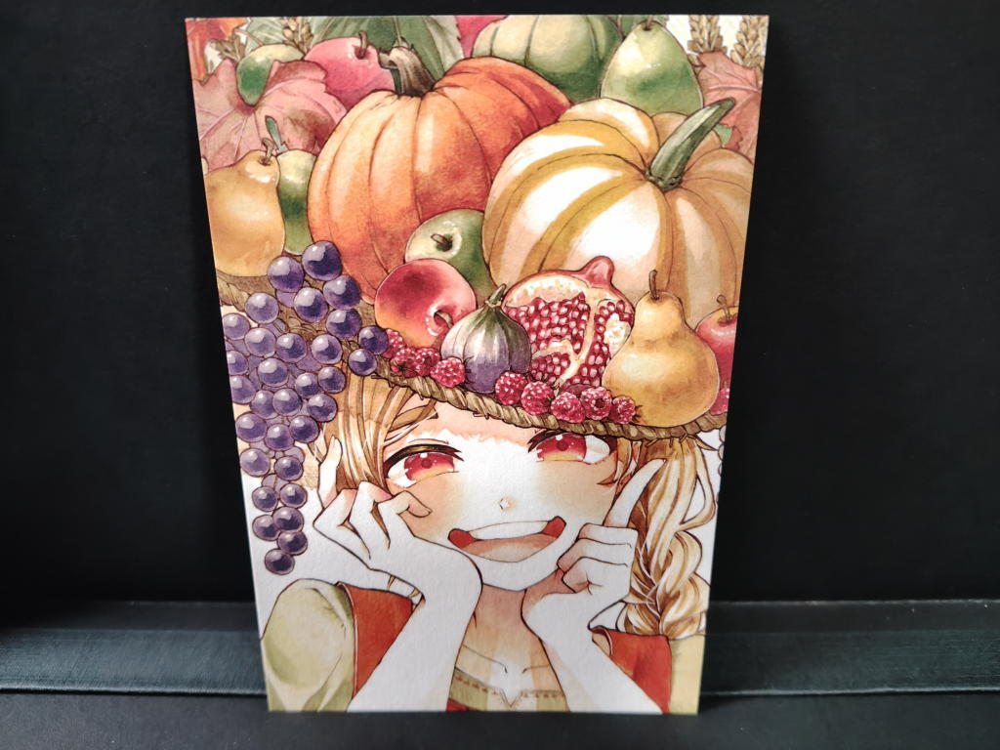

---
tags:
    - exhibition
date: 2026-11-06
---
# ARTs*LABo UnTitled 02
[ARTs*LABo](./arts-labo.md)

前回から随分間が開いたがひさびさのARTs*LABoでの展示会。

展示の中ではなつき明希さんのインクトーバーというのが印象に残った。

10月1日から31日まで、お題に沿ったイラストを毎日描くイベントのようで
魔女のイラストが31日分額装されて飾られていた。

11日のレスキューと27日のdumbあたりが好き。

<https://x.com/ARTs_LABo/status/2118646317690020007>

## お迎えポストカード
敬称略...
### ものゆかし

### 瑛

### もじ

### myk

この原画がわたしの滞在している間にお迎えされていた。

### 祭燈(さいとう)

収穫祭

<https://x.com/saito_mtr/status/2100547222303871269>
## リンク
- <https://artslabo.net/event_guide/artslabo-untitled-02/>
