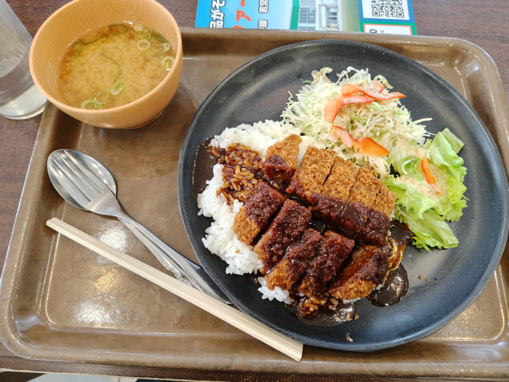
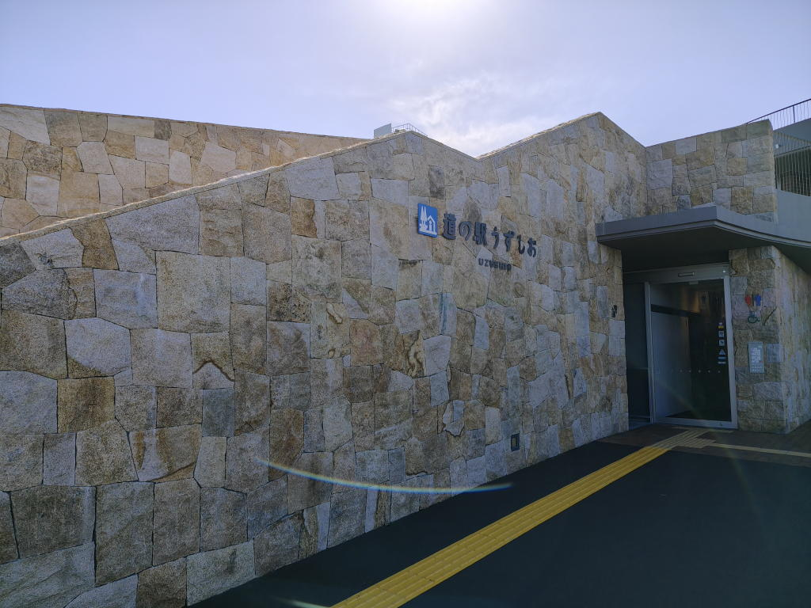
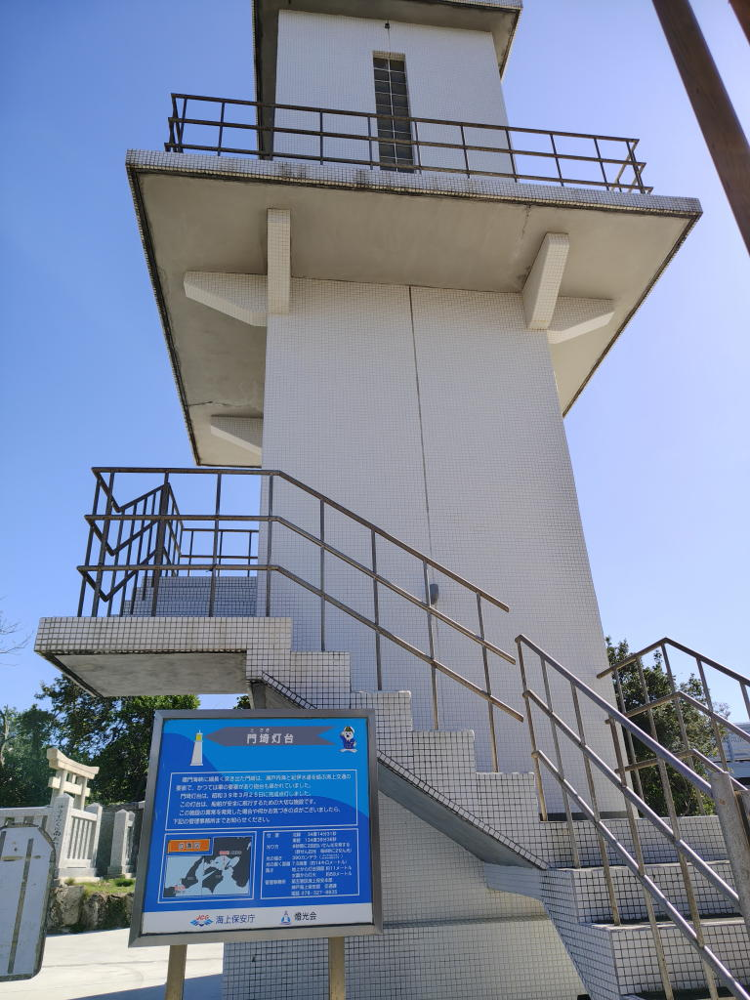
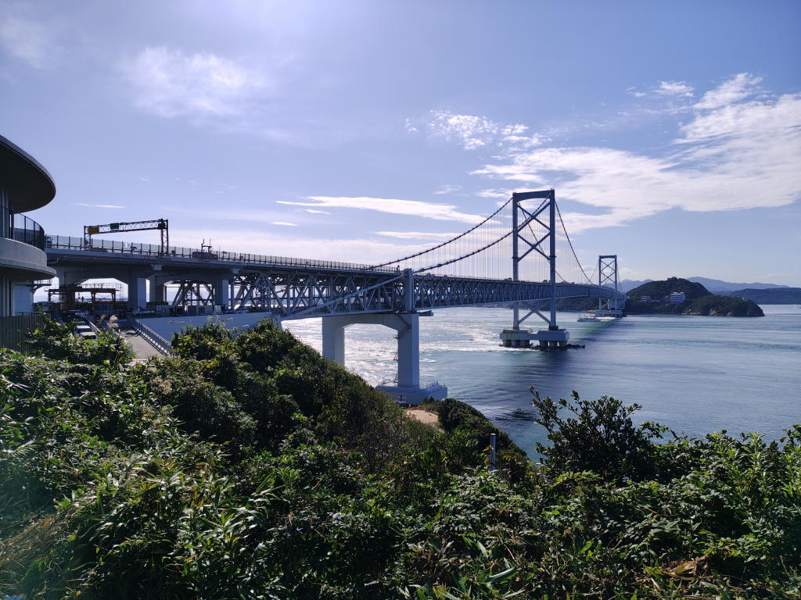

---
tags:
    - trip
    - hyogo
    - kagawa
    - tokushima
date: 2026-10-29
---
# 2026年中国・四国家族旅行1日目
## きっかけ
わたしの実家は北海道にあるのだが、ときおり両親が車旅行で内地の旅行をしている。
今回は中国・四国地方を回るということで私も東京から合流して同行することにした。

大人になって自立（独立？）してしまうと家族で一緒に過ごす機会もなかなかないし、
こういう機会を大事にしたいという想いもあった。

## 移動
東京(07時48分)→新大阪(10時15分)の新幹線のぞみ13号で移動。
新幹線的な乗り物に乗るのは中国の高鉄以来だなと思いながら乗車する。

西日暮里で乗り換えるときにICときっぷの併用に慣れていなくて若干緊張したが、
先に乗車券を通してからICをタッチすると通ることができた。

新大阪の改札口で両親と合流し、ここからは車に乗って四国へ移動。

## 神戸六番館
京橋パーキングエリア3階にあるレストラン。京橋かつめし。1000円。払ってくれた。

<https://www.hanshin-exp.co.jp/drivers/pa_guide/01pa_kyobashi/>

## 明石海峡大橋
いずれ記事にできればと思っているが、2017年に明石を観光したときに遠くから眺めたことがある。
今回は車で、家族と一緒に、こんな形で渡ることになるとは...

## 道の駅うずしお
淡路島の南端。かかっている橋は大鳴門橋。

門埼灯台

正直、どれが渦潮なのかよく分からなかった...

## 大塚国際美術館
入館料3300円!両親が払ってくれたのだが...

ただ、地下3階から地上2階まで、古代から近代までの作品がずらりと展示されていて
ゆっくり見すぎるとどれだけ時間があっても足りないような見ごたえのある美術館だった。

多分、よく言われているようなルーブル美術館もこんな感じなのだろうな。
ターゲットを絞って効率よく鑑賞しないとということだろう。

写真OKで色々と撮影はしたのだが、省略...

<https://o-museum.or.jp/>

「大塚」は大塚製薬のこと。

ポストカードを3枚お迎えする。

- モネ 日傘の女 <https://commons.wikimedia.org/wiki/File:Claude_Monet_023.jpg>
- ミレー 落ち穂拾い <https://commons.wikimedia.org/wiki/File:Jean-Fran%C3%A7ois_Millet_-_Gleaners_-_Google_Art_Project.jpg>
- モネ 印象・日の出 <https://commons.wikimedia.org/wiki/File:Monet_-_Impression,_Sunrise.jpg>

## 本家
私の家の本家は香川県にある、というのはなんとなく知っていたのだが、今回の旅行で初めて訪問した。
と言っても、外から見ただけで中には入らなかったのだが。
農村地帯の一軒家で家の脇に墓が建っていた。

父方の曾祖母の親の出身地、らしい。高祖母。高祖父。4代上。

とりあえず、私のルーツの一端だけでも分かったということで。

## 東横INN高松駅前
両親が2人で旅行している間は車中泊をしているのだが、私に合わせてくれたのか
ホテルを取ってくれていた。そして、このホテル代も親が負担してくれている...

ところで、ホテルにナイロンタオルやスポンジがないのは多くの国ではタオルでゴシゴシ洗うというのは一般的でなくて
泡立てて手で洗うかららしい。

家でもこれをやろう。そうしたらモノが一つ減らせる!
## 魚民 高松駅前
ここで夕食を食べた。

## つづき
[2日目](./chugoku-shikoku-trip-20261030.md)へ

