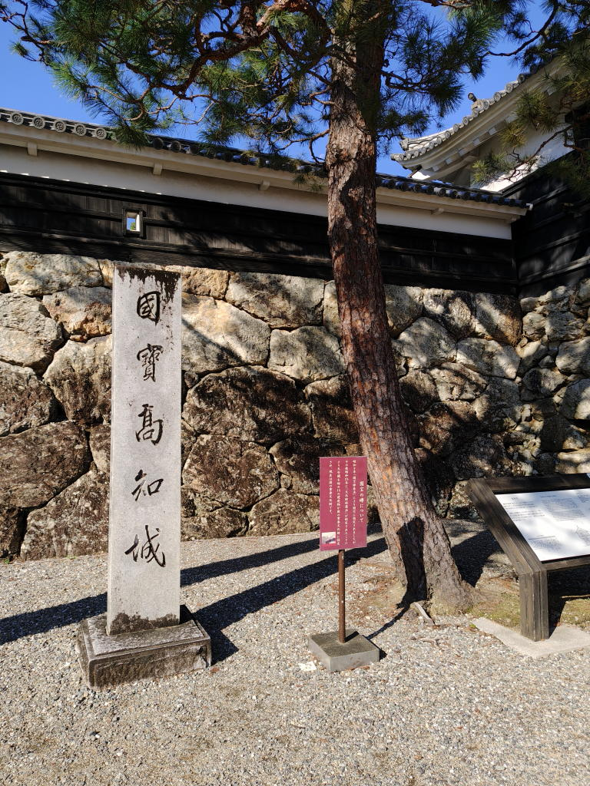
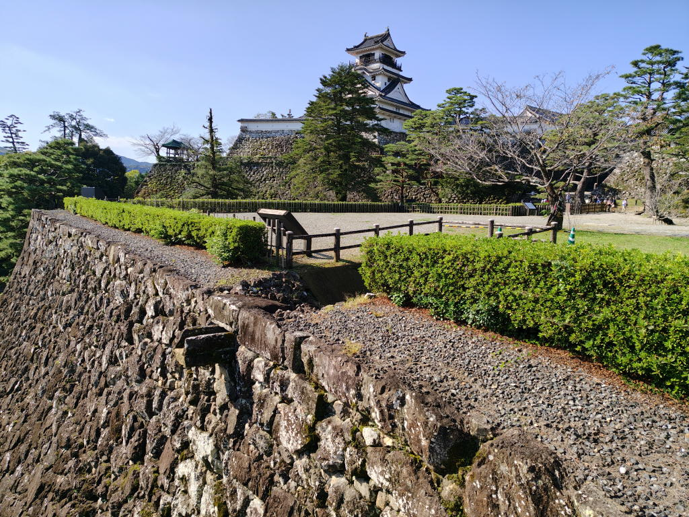
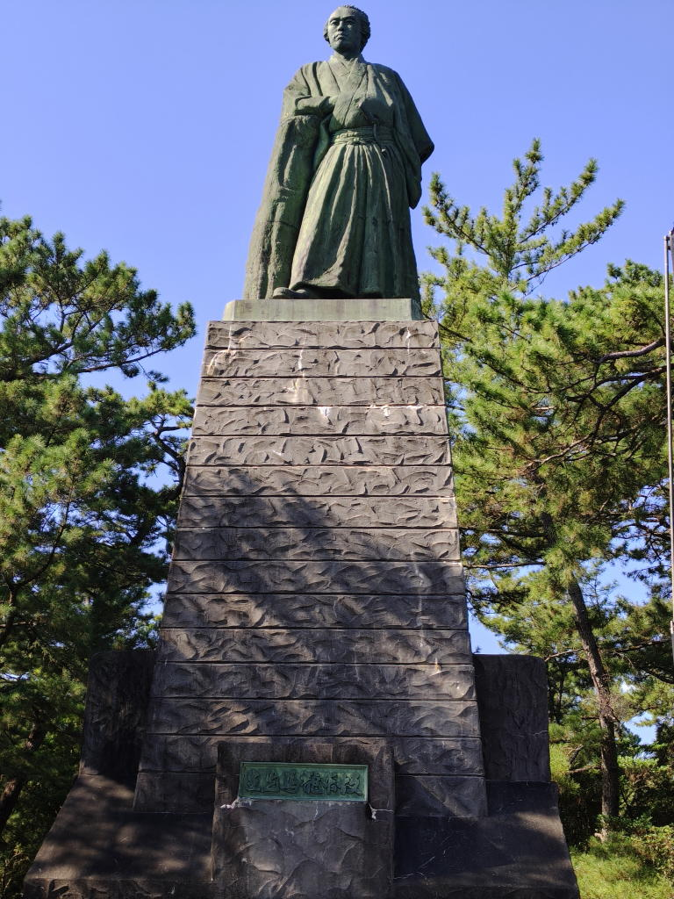
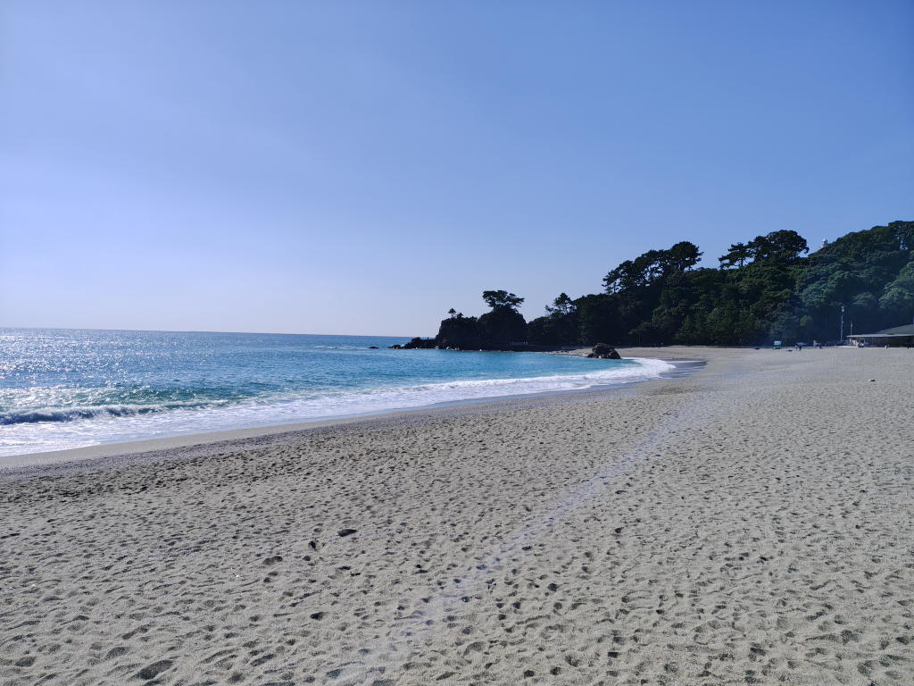
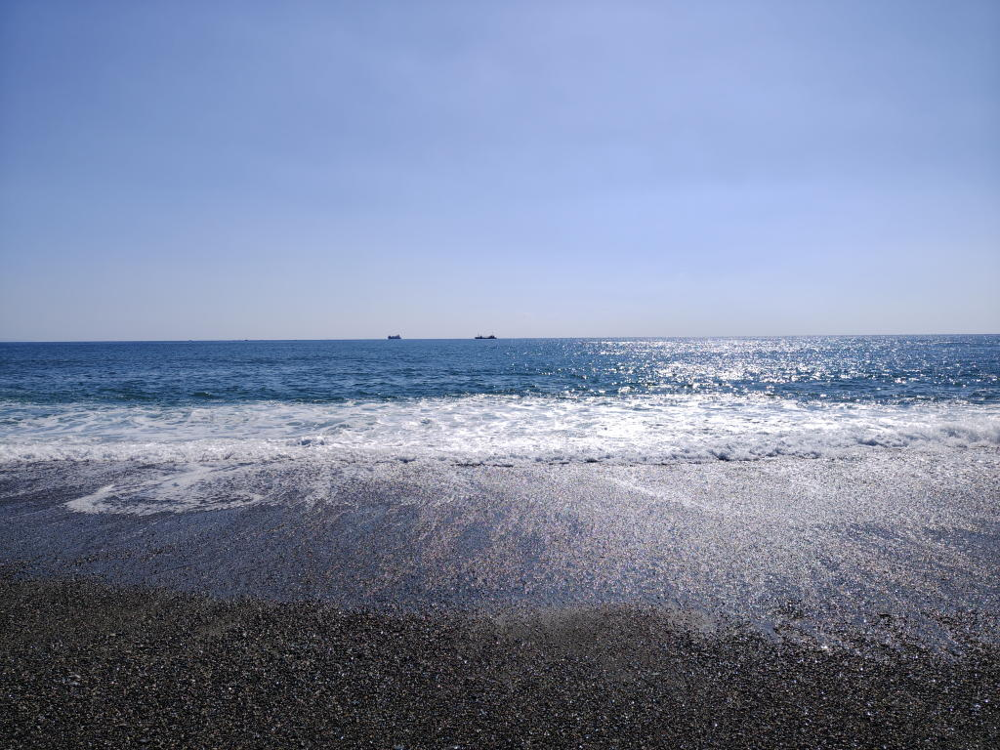
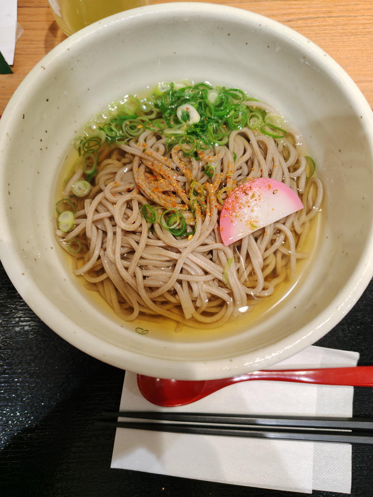
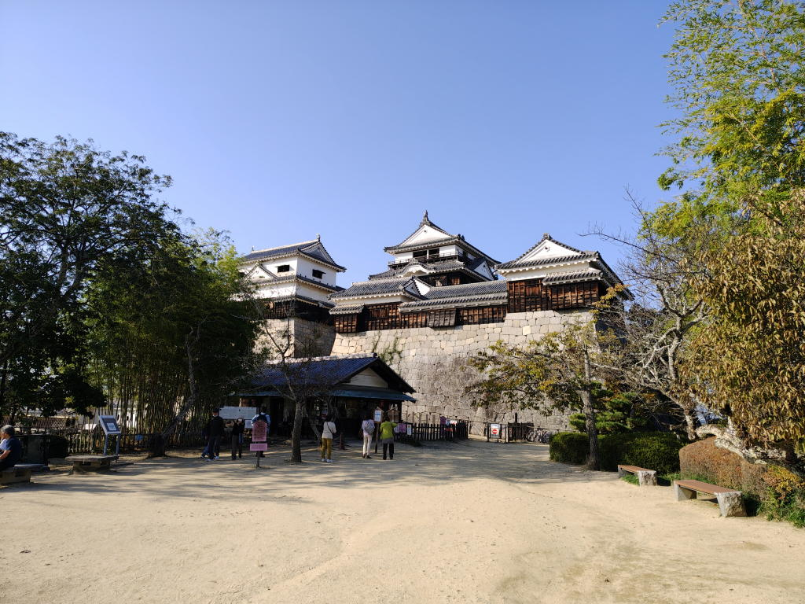
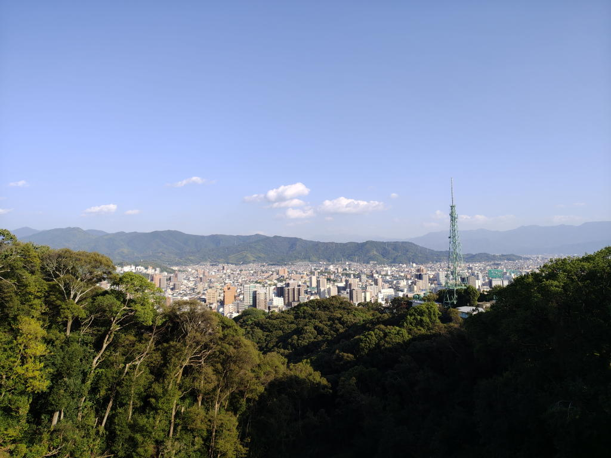

---
tags:
    - trip
    - kochi
    - ehime
date: 2026-10-31
---
# 2026年中国・四国家族旅行3日目
[2日目](./chugoku-shikoku-trip-20261030.md)のつづき

## 高知城
かつて（昭和9年）は国宝だったが、昭和25年に文化財保護法が制定されたことで
重要文化財に格下げ?されたらしい。

そのときのなごりか国宝の碑がある。

親の体力状況から三の丸で引き返す。

## 桂浜
坂本龍馬像で有名な場所。

波打ち際にいたら波が足元まで来てびしょぬれになった。

野根まんじゅう、160円。買ってもらった...。

<https://nonemanjyu.com/history.html>

天皇家のお茶受け菓子として有名だそう。

## モテナス馬立（高知）
かけそば

## 松山城
ここも両親の体力状況を鑑みて昇降にリフトを使って天守には登らず。

わたしも城は詳しくないし、それほど興味もないのだけど...
実際、城は外から見たほうが良いような気もする。

## ホテルカジワラ
松山駅近くのビジネスホテル。

部屋は可も不可もなく...

## ご飯とお酒 なが坂
ホテルの裏あたりの居酒屋。鯛めし釜めしがおいしい。

## つづき
[4日目](./chugoku-shikoku-trip-20261101.md)
