---
tags:
    - trip
    - ehime
    - hiroshima
date: 2026-11-01
---
# 2026年中国・四国家族旅行4日目
[3日目](./chugoku-shikoku-trip-20261031.md)のつづき
## ホテルカジワラ
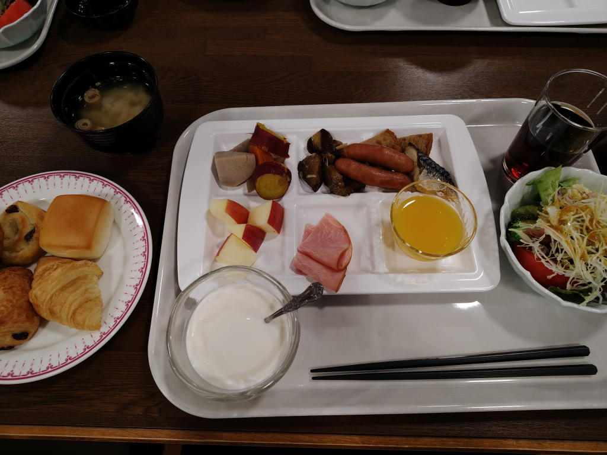

朝食バイキング

## しまなみ海道
車で渡る。

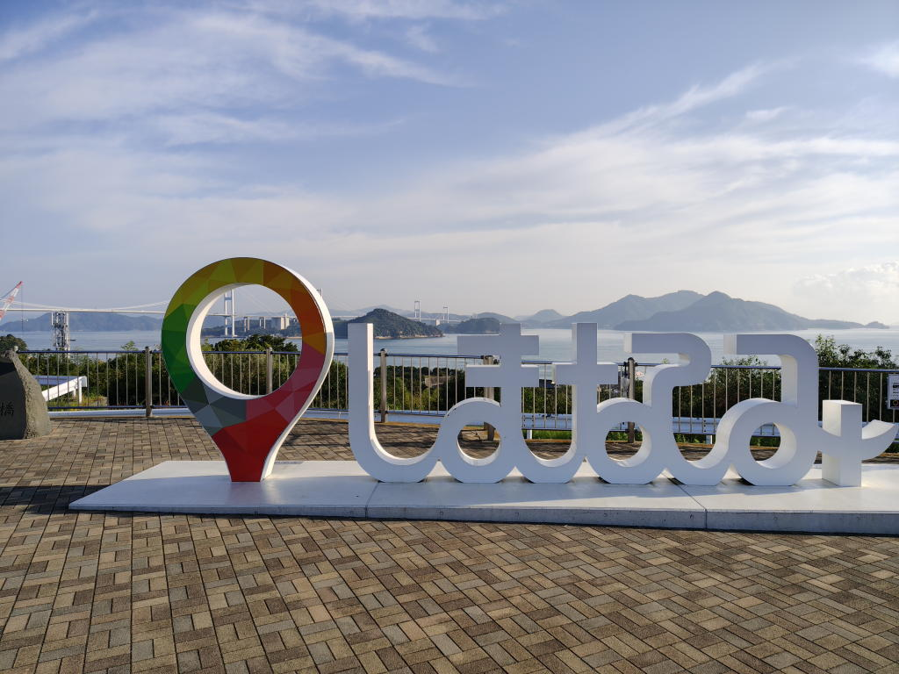

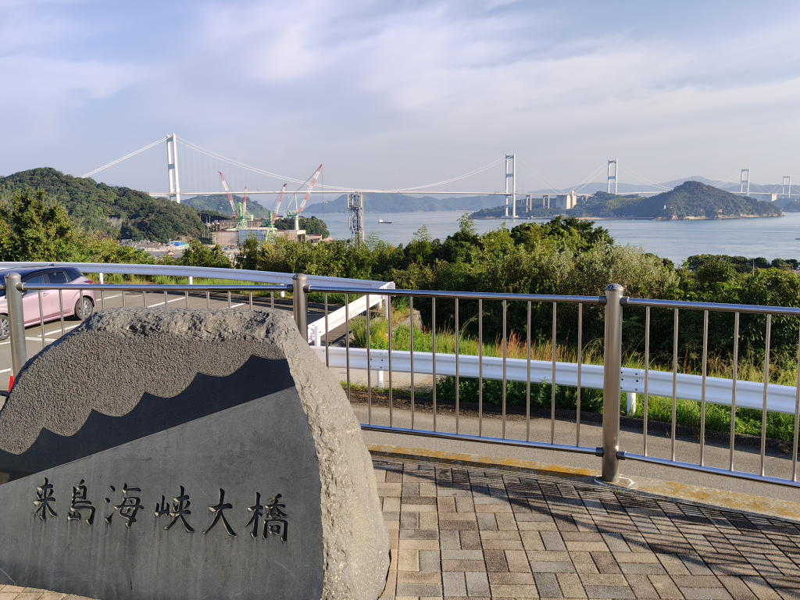

## 尾道
[esoratetora 個展 esoragoto](./tobichi-tokyo-esoratetora-esoragoto.md)で尾道のイラストを見たこともあって
私が寄りたいと伝えて立ち寄った。

あまり時間がないというのもあって千光寺の展望台に行くことに。

ロープウェイで登って、帰りは千光寺に寄ってそのまま歩いて降りてきた。

...次は一人で、冊子を持ち歩きながらゆっくり巡りたいな。

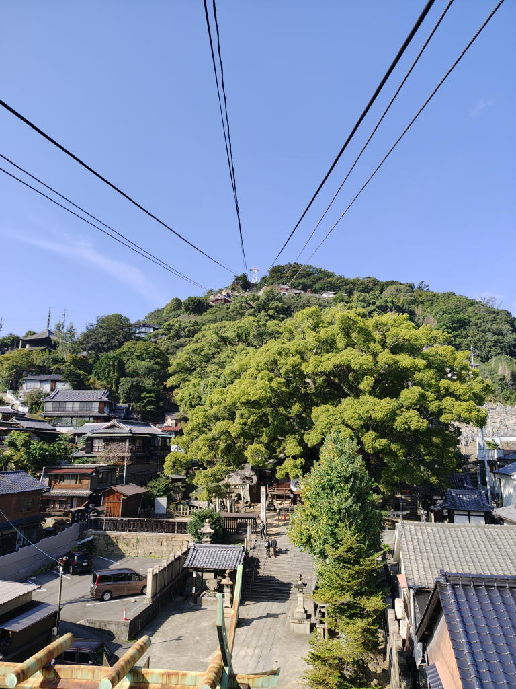

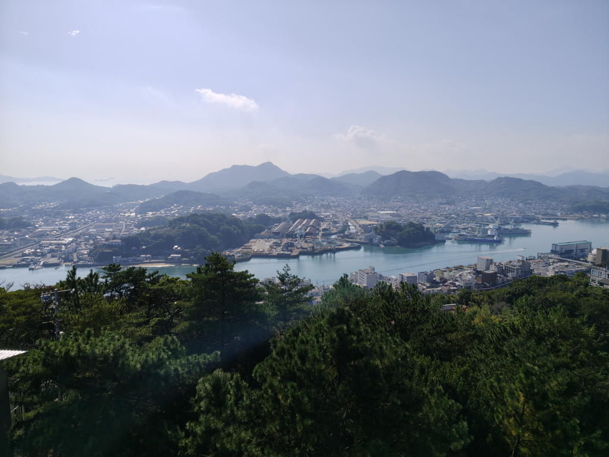

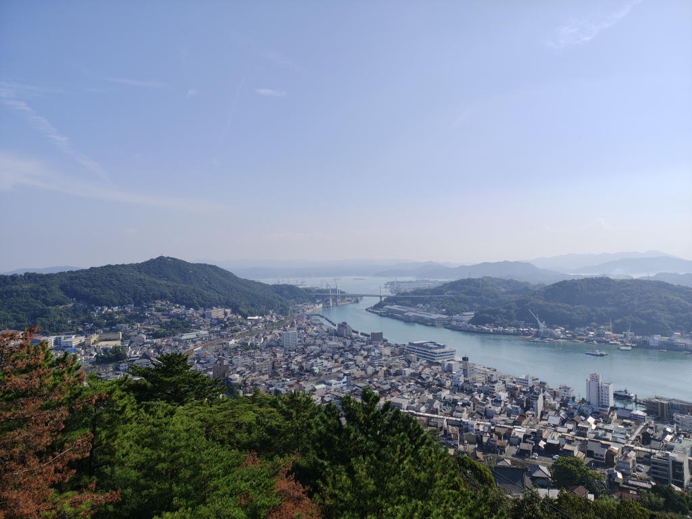

下りで猫にも会えて満足...

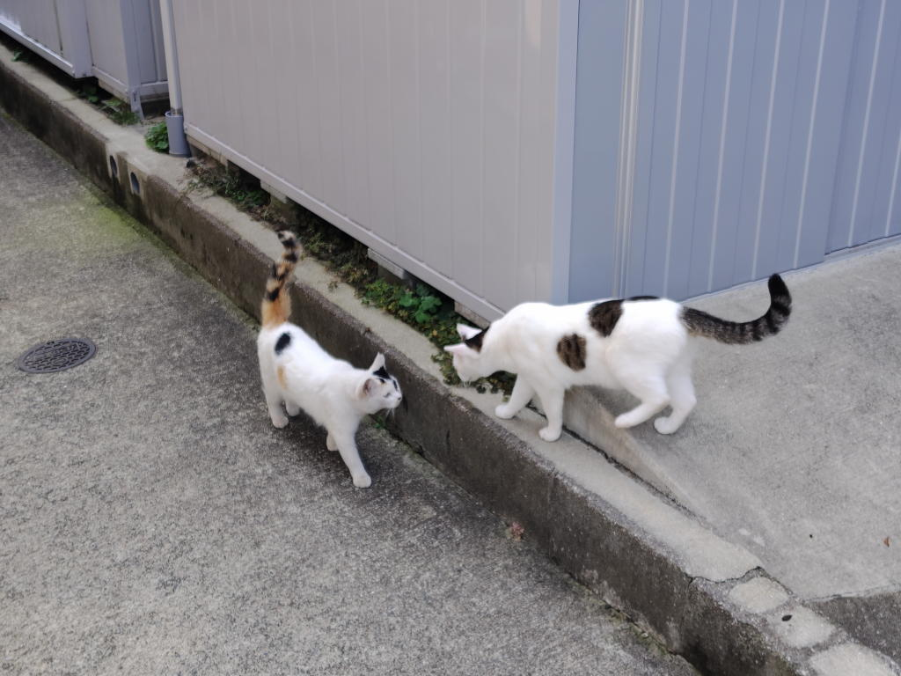

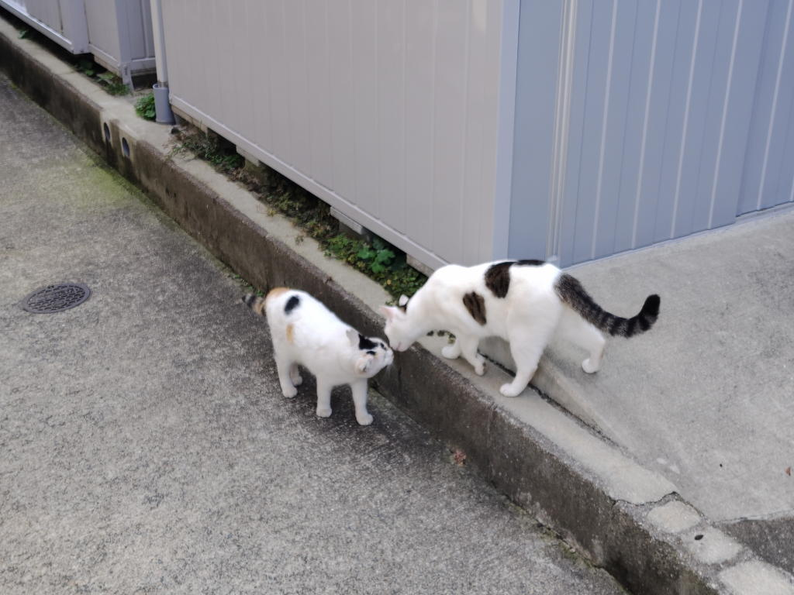

Chu...

## 広島駅
2024年11月にも来たことがある。その時はここの北にある神社に寄ったのだが...まあ、いずれ記事にしよう。

駅構内の「ひろしまギョウザ」という店（たぶん居酒屋）でぎょうざとカキフライ、白飯を食べた。

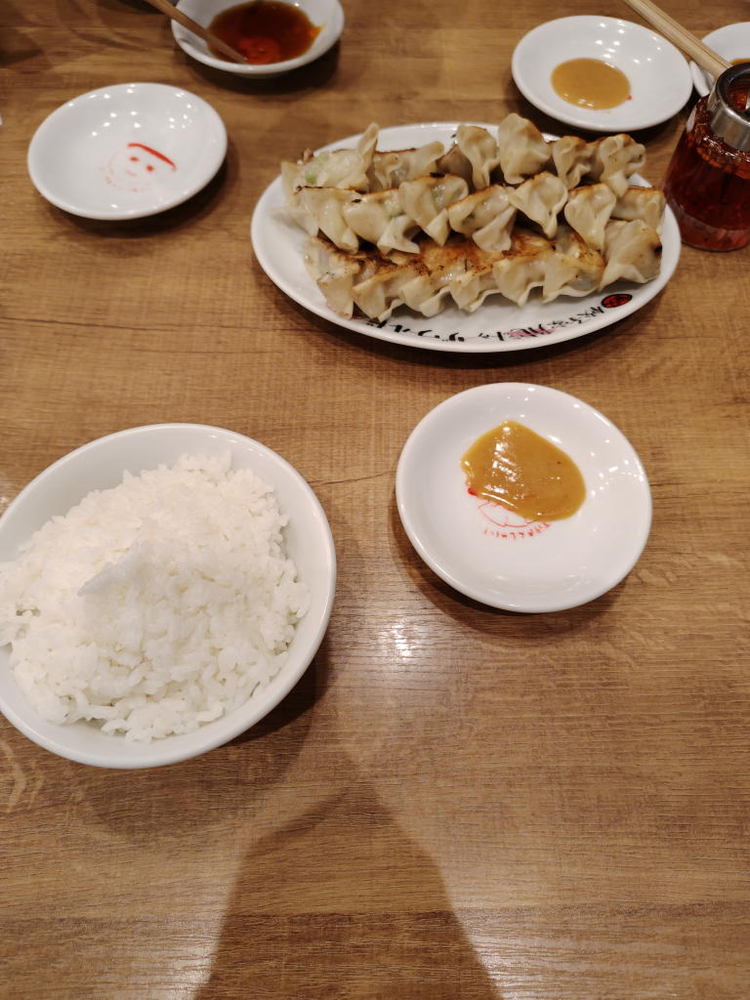

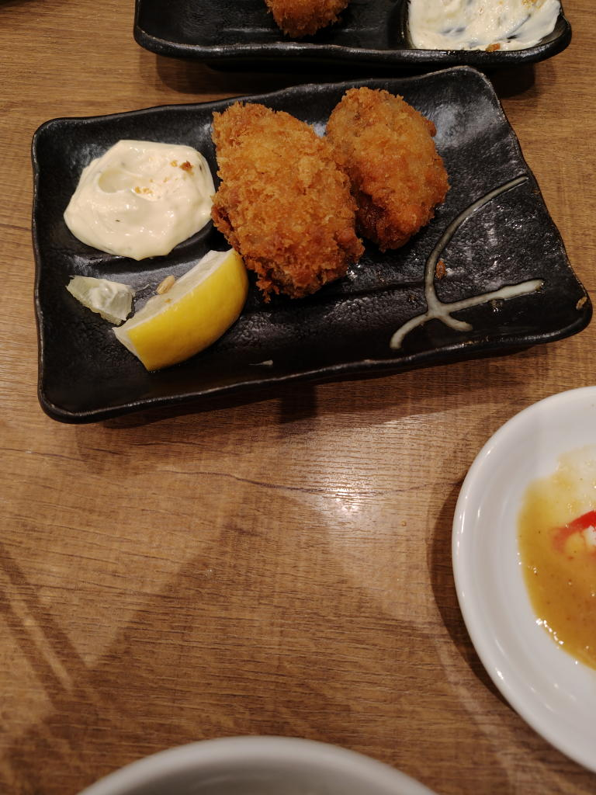

おいしい！

## 帰り
ここで両親とお別れ。わたしは新幹線で東京へ。

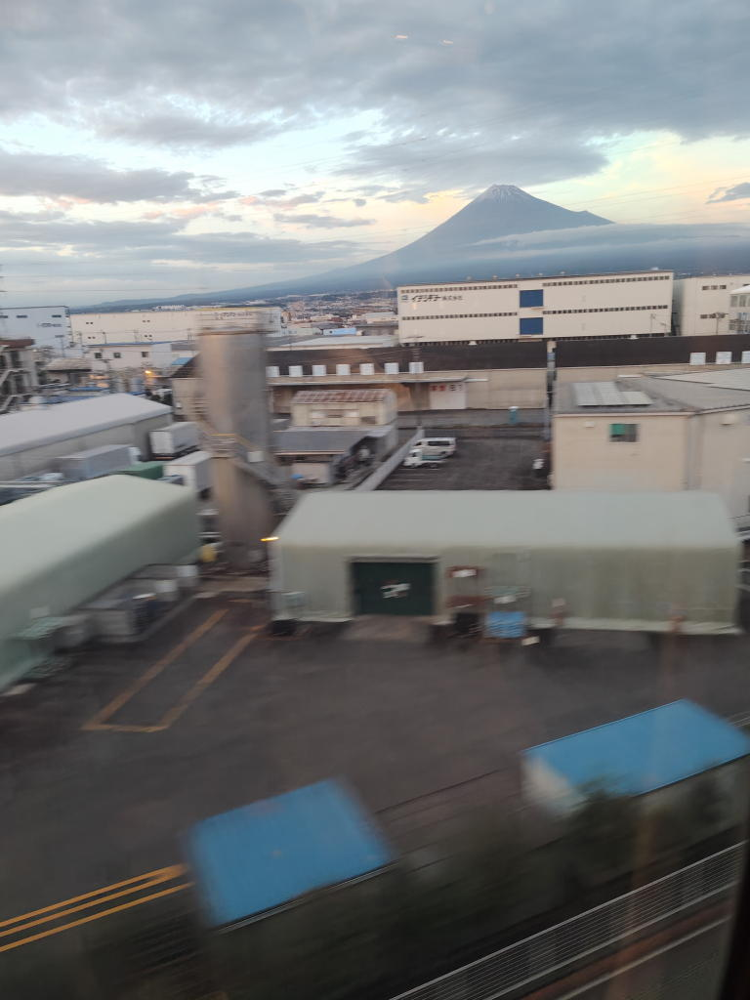

富士山が見えた。

これが最後の写真です。

## 雑記
このときは休職中だったり、ジョギング中に怪我をして何針か縫うほどの怪我もしていた。
家族にそれを伝えるべきかどうか最後まで悩んだが結局伝えることなく（笑顔で？）別れた。

まあ、話したからと言ってどうなることもないし、どうしてほしいということもなかったのだ。
この問題は私自身でケリをつけたいという思いが強かったのかもしれない。

新幹線の往復代は自腹で払ったのだが、ホテルの費用や各所の入場料等はすべて両親が持ってくれた。
これは一般的なのか、甘やかされているのか...なにかの形で返したほうが良いのだろうと思う...

車旅というのも楽というわけではなさそうに感じた。駐車場を探したりしないといけないし、
小回りがきかないような感じがした。あるいは、自分で計画を立てていないからかもしれない。
やはり計画を立てるところからが旅行なのだろうと思う。

私は公共交通機関を使うほうが好みだな。

やっぱり、計画を立てて準備をして、その上でというのが旅の醍醐味なのかもしれない。
ミニマリストだからほしいものもないし、そういうところにしか価値を見いだせないのかも。
お土産とかを見ても一切ときめかないのだ....

