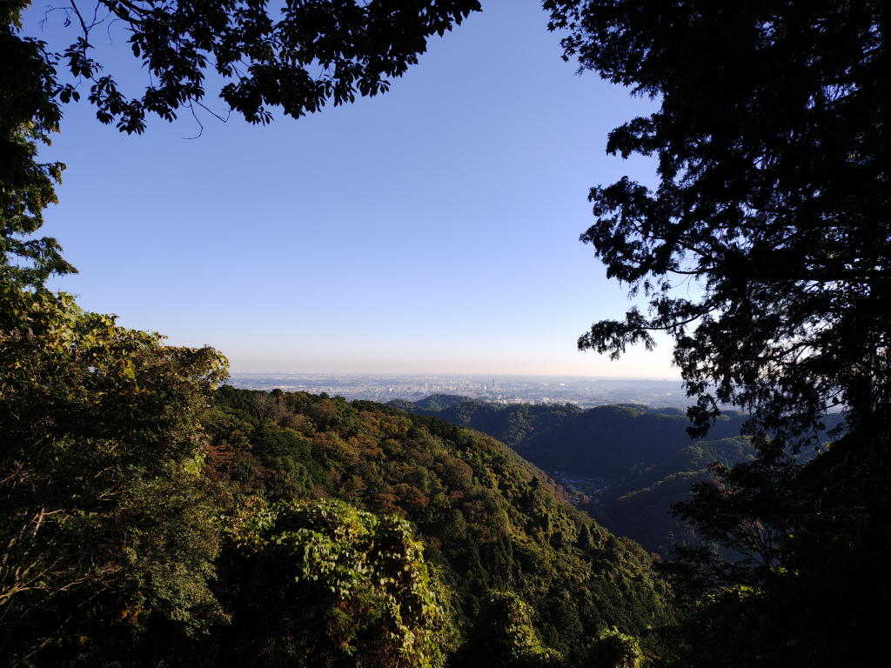
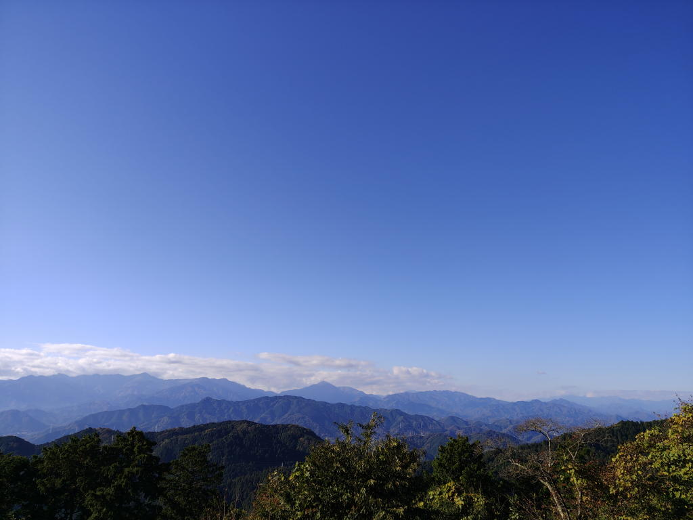
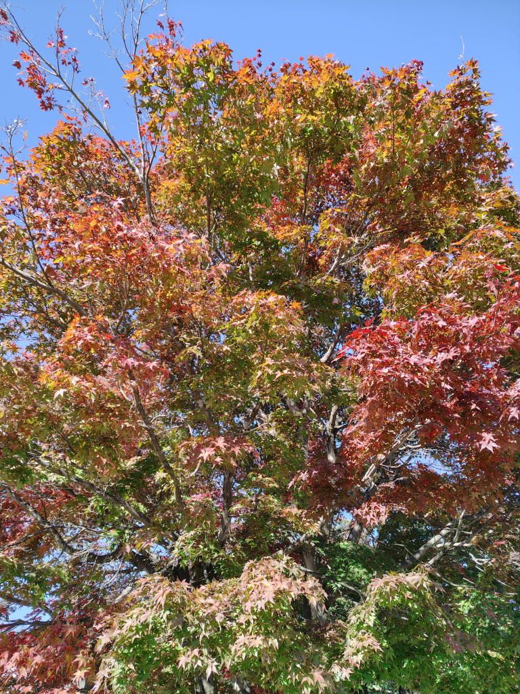

---
tags:
    - hiking
date: 2026-11-12
---
# 高尾山 17回目
9月14日に[扇山](./ougiyama.md)に登って以来だからほぼ2ヶ月ぶりの登山ということになる。

振り返ってみると、そのすぐ後に転んで怪我をして、治りかけた頃にまた転んで怪我をして...
そのあと[家族旅行](./chugoku-shikoku-trip-20261029.md)に行って。

と考えると2ヶ月のブランクがあるのも頷ける。

今回もいつもどおり稲荷山コースをつかった。そして、いつもは通勤に使っているリュックとスニーカーで登っていたが、
練習?も兼ねてザックと登山靴という本格的な登山用の装備で登った。

ブランクは長かったけど、体力が衰えているということは特になさそう。今までと同じくらいのペースで登ることができた。

## 写真

稲荷山展望台から

山頂から。富士山は雲を被っていた。

これも山頂にて。紅葉していたのはこのあたりの木々だけで、山腹の木まで紅葉するのはもう少し先になりそう。

## メモ
YAMAPではなくComapsのトレース機能を使ってトラッキングをしていたが、
終わった後にデータを確認すると標高の値が突然飛んでいたり、全体的に値が高めにずれていることに気づいた。

[国土地理院API](./gsi-kokudo-chiri-in-api.md)を使って補正した。

