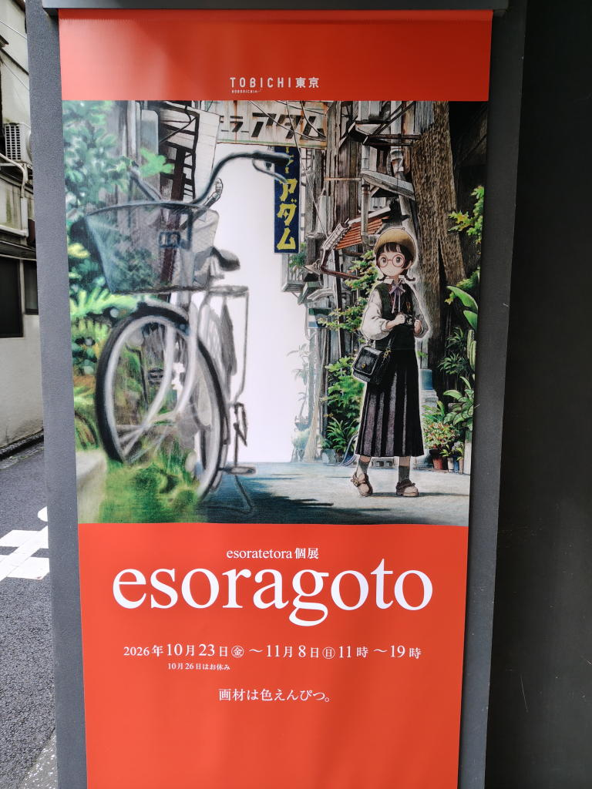
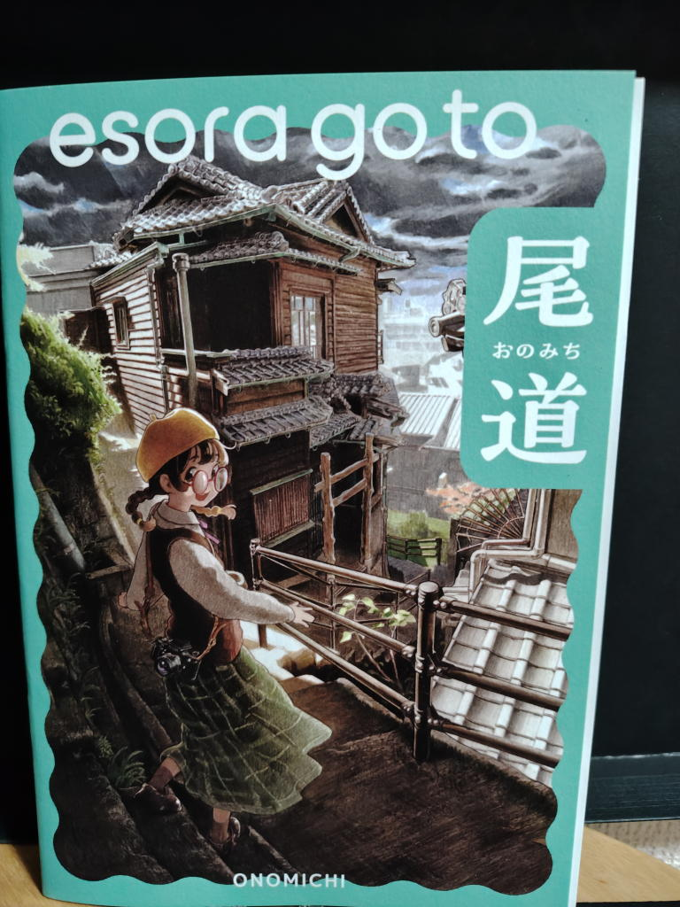
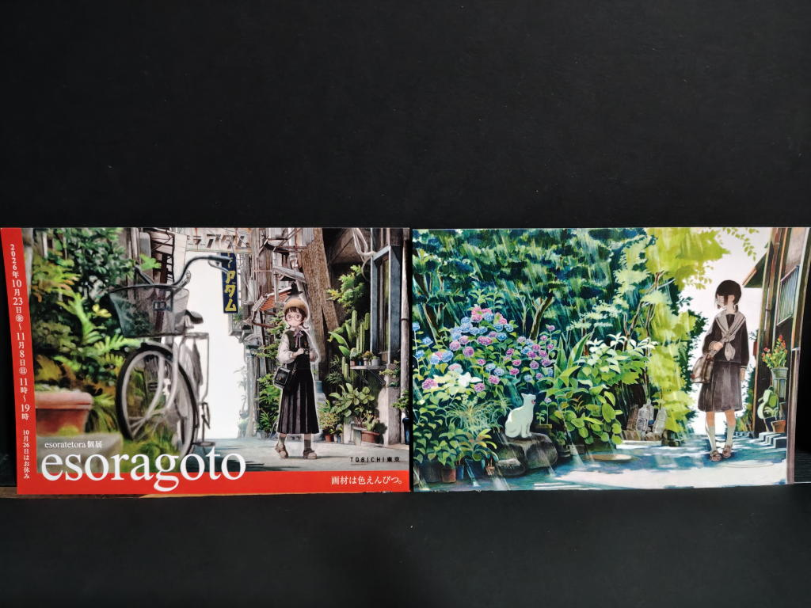

---
tags:
    - exhibition
date: 2026-10-23
---
# esoratetora 個展 esoragoto
- 訪問日: 2026年10月23日
- 場所: [TOBICHI東京](./tobichi-tokyo.md)

## きっかけ
水井軒間さんが推していた。

<https://x.com/mizuinokima/status/2105536667394478557?s=20>

## 雑記
神保町にはよく行っているが、こんなところにほぼ日の店舗があるなんて知らなかった。
まあ、私はほぼ日手帳を使っているわけでもないのだが...
平日だがお客さんもそれなりにいて賑わっていた。

イラストはリアルな背景に可愛い女の子、舞台は尾道。
インタビュー記事を読むとばらスィーさんの作品に触れていた時期があったようで、
確かに近いものを感じた。

題材的にはラブライブの『Find Our 沼津』にも近いかもしれない。どっちが先かというのは置いておいて。

色鉛筆でここまでリアルな絵が描けるのかと、驚きというか感動。

正確にモノを見たり、それを2次元に落とし込む能力みたいのが段違いなのだろう。
私には真似できそうにない。

ポストカードと尾道のイラスト旅行記（同人誌?）をお迎えした。
この本を連れて歩いてみたい。

在廊していたのだが、結局声を掛けられず...。画集の発売が会期後半のようで、
そのときにまた訪問してみようかな。
## お迎え品
イラスト集

ポストカード

## リンク
- インタビュー記事 <https://www.1101.com/n/s/esoratetora/index.html>
- 個展案内記事 <https://www.1101.com/tobichi/tokyo/exhibition/detail/?p=15849>
