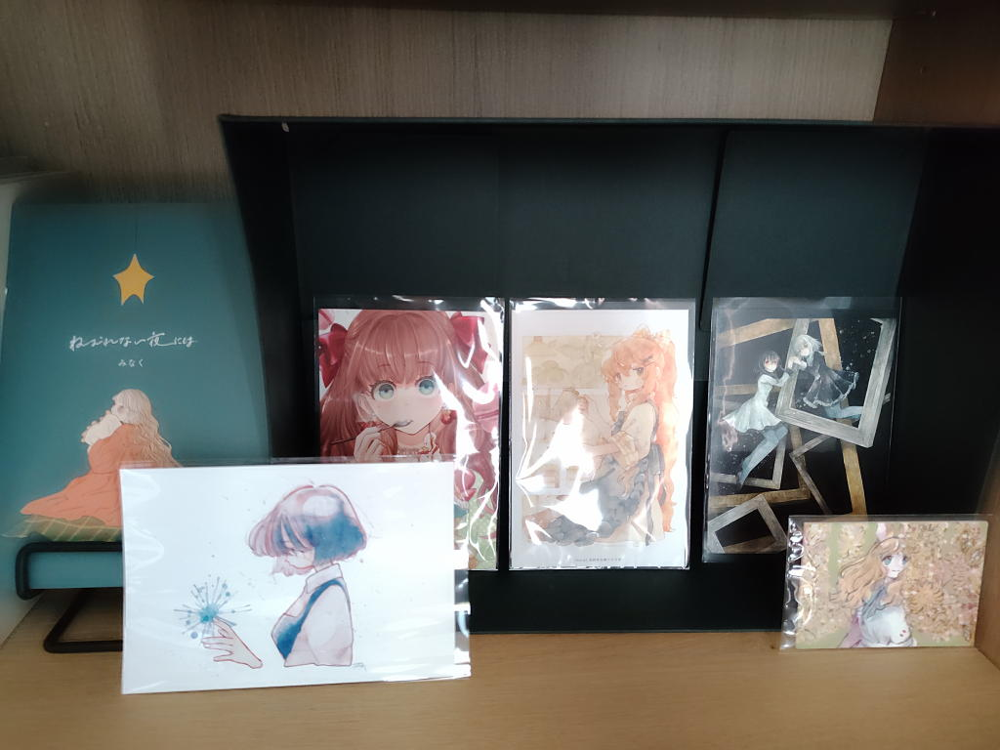

# ずっとやりたかったことを、やりなさい 9週目の課題
## 現在の仕事で自分の中に積もった怨恨（怒り）のリストをつくる
- 同じスキルを持った人間が他にいない。
- 自身の成長の限界、持続性がない（後任がいない）
- 実益を優先しがち、短期的な利益が評価される傾向にある

## 取り掛かっている作品についての不安や、それがどのような受け止め方をされるかについての不安を残らずリストアップする
- 他人から見ると良く分からない知識や技術をつかって却って分かりづらい状態にしているようにも見える
- 私の取り組みがどれだけ評価されているのかわからない
- 自分がいなくなったあとのことを考えると取り組む意味がない
- 最終的には自分がいなくても管理できる状態=私が取り組み始めた時点の状態に戻すしかない

## この作品を作らなかったら、代わりに何が得られるか、自分に聞いてみよう
この作品というのが今の仕事を指しているのだとして、
休職することによって

- 「創作」の定義を広げることができた（どういう形であれ、個性を表現すること）
- モーニングページを書き続けている
- note、mkdocsなどをつかってアウトプットをするようになった
- コミックアートの展覧会やイベントに参加するようになって、自分の「好き」の幅が広がった。

## 創造の神様と取引
「わかりました創造の神様、作品の出来はあなたにお任せします。私は作品を作り続けることに専念します。」

と書いた紙を目立つところに貼る。

## 今週の課題
### モーニングページを読み返す
「洞察」と必要な「行動」に線を引く。
### モーニングページで不満を述べてきた相手は誰か。手を付けずに先延ばしにしたものはあるか。
主に会社に対する不満を述べている。しかし、今の会社を離れるための行動を起こしていない。
誰かが手を差し伸べてくれるのを待っているようにも感じる。そんな手が存在しないことはわかっているが...

### 目標を達成した自分をイメージする
静かな場所、自分のペースで仕事や作業ができる。プログラミングで生計を立てる。

あるいは小さな本屋や喫茶店のような場所で仕事をする。
そこに自分の好きなイラストを飾ったり展覧会を開いたりできるようにする。

利他的、寄付、ボランティア、そういった活動に従事できる程度の経済的な余裕が必要。

### 優先順位を確認する
1年間、1ヶ月、1週間という順で、最終ゴールに行き着くまでの目標をリストアップする。

- 1週間: 先日、転倒して怪我を負ってしまったのだが、まずはこれを治すこと
- 1ヶ月: キャリアカウンセリングを受けたい
- 1年間: 生計を立てることと生きがいを満たすことを両立できる道を見つける。

抽象的すぎるか...
### 特に辛かった挫折経験に名前をつける。将来の自分を励ます肯定の言葉のリストをつくる
10年ほど前の失恋、手痛い経験だったが、私をすっかり変えてしまったし必要な経験だったと今は思っている。
この件はもう整理できていると言ってもいいのかもしれない。

適応障害。10年間、仕事を中心にした生活を送ってきたが、躓いてしまった。
私は物欲がない上に簡素な生活を好むタイプだし、資産形成も相当にしているから
フルタイムで働く必要もおそらくない。その上で何がしたいのかを考えたほうが良い。

休職しているといえばそうなのだが、立ち止まって次に何をしたいのかを考えるための期間とも
捉えることができる。

### 自分で放棄したり、他人に妨害されてやめてしまったりした作品のなかで救出できるものを探してみる。
見つかったらそれを完成させよう

作品というわけではないが、もともとは情報系の専攻に進もうと思っていたところを
家族の意向で別の道に変えたという経緯がある。今の仕事はその道の延長上にあるわけだが、
そこから考えると、自分の意志で選んだ仕事ではないということになる。

就職活動も順調に行ったとは言い難いが、その頃からモノのためじゃなくて
人のために働きたいとボヤいていたのは今でも記憶に残っている。

この人のためというのが寄付という形で具体化しているのが今の状態なのだろう。

### 創造性回復のコースを続けていくことに抵抗を感じている場合、どのような抵抗か探ってみよう
モーニングページは苦になっていない。休職中で時間に余裕があるというのも一因だが、
昔から躓いたときにはとにかく言葉に残そうとする傾向があった。

いつか忘れてしまうとわかっていたから、とにかく書いて残しておきたいと思っていたのだ。
特に失恋の経験は罪の意識を伴うものだったから、それを刻み込む意味でも事細かに書き残していて
今でも昨日のことのように思い出すことができる。

ただ、現状維持を求める気持ちはどこかに残っている。
就活もスムーズに行ったわけではないから、転職と言ってもそうかんたんに
私を拾ってくれる場所が見つかるのかという不安が根強く残っているから一歩を踏み出せないのだろうと思う。
### 自分のトーテム像を選ぼう
それをピッタリの場所においてあげよう。

今これと言って思い浮かぶものはないが、自分のトーテム像...

昨日、TCMでみなくさんの『ねむれない夜には』という絵本をお迎えした。

とても私にふさわしい?とも思えないが、こういう温もりにあふれた内容のものに惹かれる傾向が幼い頃からずっとある。可愛いものが好きというのは今に始まった話ではない。

「なんであれ、あなたがそれによってたちどころにやさしい愛に包まれているように感じられることが大切なのだ」

そういう意味では先の絵本やにぇりさんの『もるとEmmyの毎日』だろうか。

2026年10月15日追記

こんな感じで飾ってみた。
